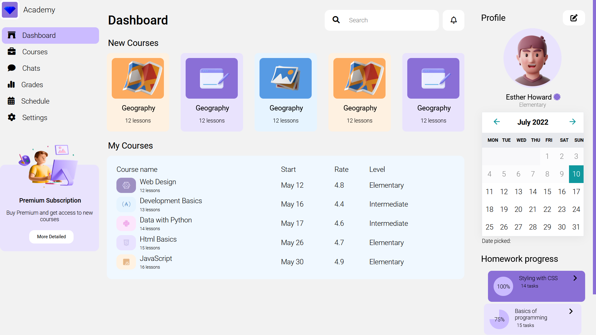

# Academy — Modern Study Web Dashboard

[](https://github.com/cenaei/Axies)
[](https://developer.mozilla.org/)
[](https://www.w3.org/WAI/standards-guidelines/wcag/)
[](#dark--light-theming)
[](#responsive-bento-layout)
[](LICENSE)

An accessible, responsive, and high-performance educational web dashboard built with modern semantic HTML5, fluid CSS Custom Properties (Design Tokens), and strictly scoped zero-dependency JavaScript. Originally inspired by the classic Dribbble [Study Web Dashboard](https://dribbble.com/shots/18289015-Study-Web-Dashboard), completely re-architected to meet contemporary web and accessibility standards.

---

## Live Preview & Visuals

| Light Mode (Daylight Study) | Dark Mode (Midnight Focus) |
| :---: | :---: |
|  | *Auto-switches with OS or via topbar toggle button* |

---

## Highlights & Features

- **Zero External Runtime Dependencies**: Pure native browser technology (Vanilla HTML5, modern CSS3 variables, modular ES6+). Zero build steps or bundlers required to run.
- **Accessible Design System (WCAG 2.1 AA)**:
  - All color tokens pass strict 4.5:1 text contrast ratios against background and surface layers.
  - High-visibility keyboard focus indicators (`:focus-visible` with 2px offset).
  - Screen reader announcements via dynamic `aria-live="polite"` live regions.
  - Full support for `prefers-reduced-motion` to protect vestibular health.
- **Automatic & Manual Light/Dark Theming**:
  - Automatically respects user OS system preference (`prefers-color-scheme`).
  - Seamless manual toggle in the top bar with instant persistence in `localStorage`.
- **Responsive Bento Grid Architecture**:
  - **Desktop (>1100px)**: 3-column Bento layout with sticky navigation sidebar, central dashboard, and right-hand activity panel.
  - **Tablet (768px - 1100px)**: 2-column layout with optimized spacing and collapsible activity drawers.
  - **Mobile (<768px)**: 1-column fluid layout with sticky mobile header, smooth off-canvas navigation drawer, and swipeable horizontal carousels.
- **Security Hardening**:
  - Eliminated all unsafe `.innerHTML` manipulations across all scripts.
  - Removed all inline event handlers (`onclick`) to ensure strict Content Security Policy (CSP) compliance.
  - Fixed DOM listener leaks in the calendar component using centralized event delegation.
- **Complete Academic Tab Views**:
  - **Dashboard**: Bento grid featuring "New Courses" card carousel and "My Courses" tabular roster with level badges.
  - **Courses**: Searchable catalog with category filter pills (UI/UX Design, Development, Data Science, AI) and interactive progress meters.
  - **Chats**: Discussion channels, mentor contacts, and interactive message composer with simulated instructor replies.
  - **Grades**: Academic performance stats (GPA, Credits, Average Score) and course grade breakdown.
  - **Schedule**: Timeline of upcoming lectures with direct "Join Room" video links and time badges.
  - **Settings**: Profile configuration form, notification toggles, and keyboard navigation reference.
- **Modernized Interactive Calendar**:
  - Zero-dependency calendar with month traversal, current day highlights, leap year math, and keyboard date selection.

---

## Keyboard Navigation & Shortcuts

Academy is engineered for full keyboard navigation:

| Key Binding | Target Element | Action |
| :--- | :--- | :--- |
| <kbd>Tab</kbd> / <kbd>Shift + Tab</kbd> | Global | Navigate sequentially through interactive buttons, inputs, and cards |
| <kbd>→</kbd> / <kbd>↓</kbd> | Sidebar Tablist | Move focus to next tab and activate view |
| <kbd>←</kbd> / <kbd>↑</kbd> | Sidebar Tablist | Move focus to previous tab and activate view |
| <kbd>Home</kbd> / <kbd>End</kbd> | Sidebar Tablist | Jump directly to first (Dashboard) or last (Settings) tab |
| <kbd>Enter</kbd> / <kbd>Space</kbd> | Calendar / Buttons | Pick highlighted calendar date or activate buttons |
| <kbd>Esc</kbd> | Mobile Menu | Close off-canvas sidebar navigation drawer |

---

## Architecture Overview

```
Academy/
├── index.html                   # Semantic HTML5 WAI-ARIA layout
├── app.js                       # Scoped ES6+ application state, router, and event bus
├── vanillaCalendar.js           # Hardened zero-dependency calendar widget
├── favicon.ico                  # Application browser favicon
├── Screenshot.png               # Project visual preview
├── assets/
│   ├── css/
│   │   ├── main.css             # Design tokens, bento grid, responsive layout
│   │   └── vanillaCalendar.css  # Calendar component styling aligned with tokens
│   ├── img/
│   │   ├── avatar/              # Diverse high-res student & instructor avatars
│   │   ├── courses/             # Course illustrations & badges
│   │   ├── logo/                # Brand mark
│   │   └── navbar-bg-*.png      # Banner illustrations
│   └── sass/                    # SCSS source templates
├── tests/
│   └── verify.js                # Automated security, HTML, CSS, and date math tests
└── .scratch/                    # Formal specs and tracer-bullet tickets
```

---

## Getting Started

### Local Quickstart (Zero Install)

Because Academy requires no build pipeline, you can run it immediately with any static server:

```bash
# Option 1: Python 3 built-in HTTP server
python -m http.server 5500

# Option 2: Node npx serve
npx serve .

# Option 3: VS Code Live Server
# Right-click 'index.html' -> Open with Live Server (Port 5501)
```

Open `http://localhost:5500` in any modern web browser.

### Automated Quality Checks

Run the automated test suite to verify HTML integrity, CSS design tokens, calendar date calculations, and the absence of unsafe DOM injections:

```bash
node tests/verify.js
```

---

## Accessibility & Standards Compliance

- **WCAG 2.1 AA**: Evaluated for contrast ratios, screen reader compatibility, and focus indicators.
- **WAI-ARIA 1.2**: Implements official `tablist`, `tab`, and `tabpanel` design patterns.
- **Semantic HTML5**: Native `<header>`, `<main>`, `<aside>`, `<nav>`, `<article>`, and `<table>` elements with `<th scope="col">`.
- **Performance**: Zero render-blocking third-party scripts; self-contained SVGs for instant paint times.

---

## Acknowledgments & Credits

- Original UI design inspiration by [Dan Salahi](https://dribbble.com/shots/18289015-Study-Web-Dashboard).
- Design system intelligence powered by `ui-ux-pro-max` (Swiss Minimalism & Bento Grid tokens).
- Refactoring workflow powered by Matt Pocock agent skills (`to-spec`, `to-tickets`, `code-review`).

---

## License

This project is licensed under the [MIT License](LICENSE).
